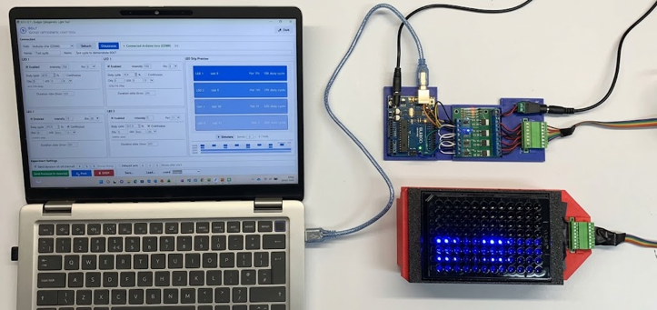
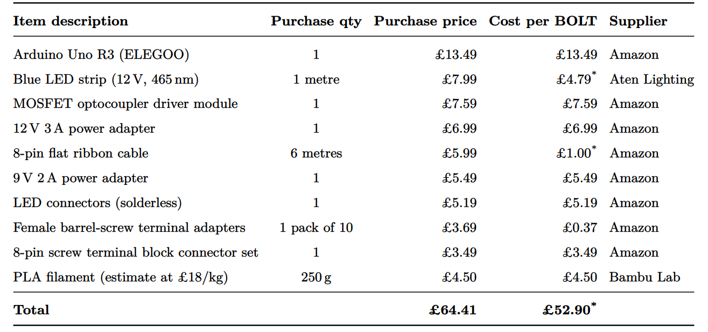
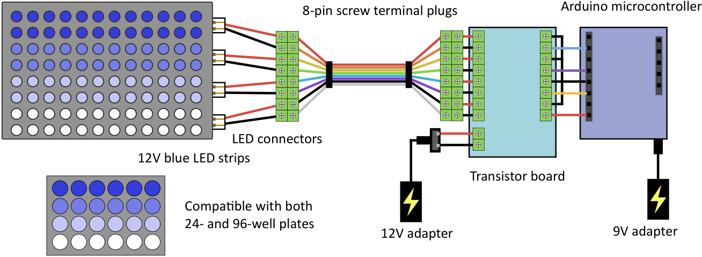
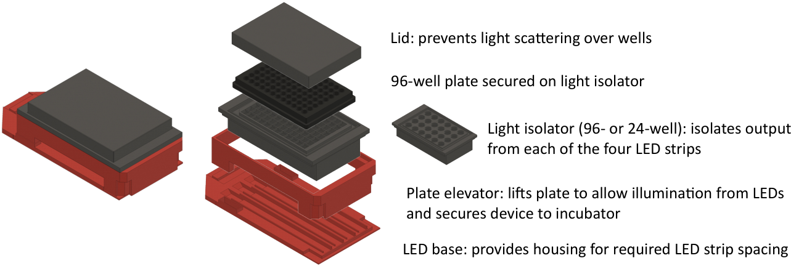
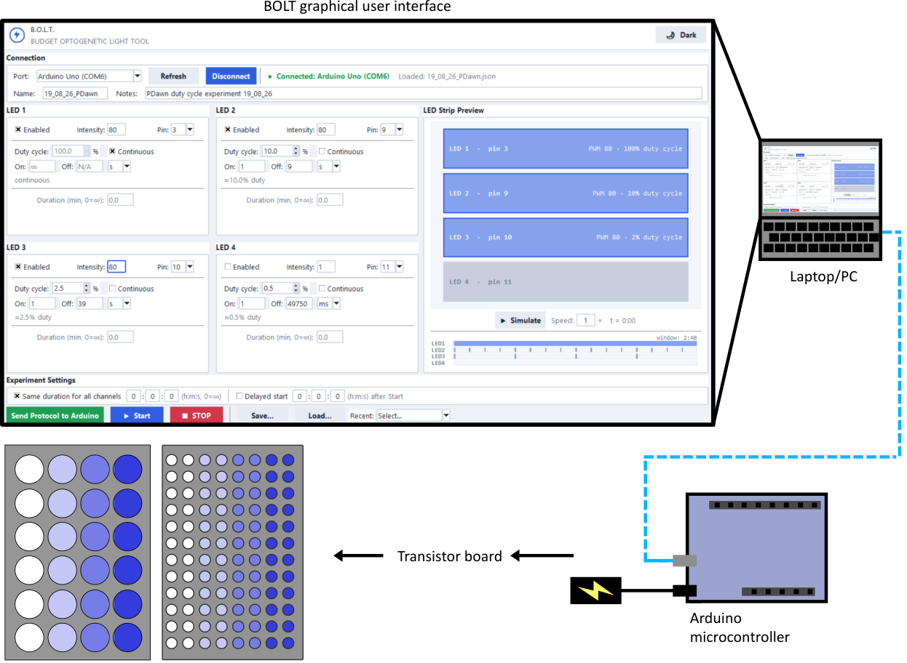

# B.O.L.T. — Budget Optogenetic Light Tool

Control 4 independently-addressable 12V LED strip channels from a laptop GUI,
for optogenetic illumination of multi-well plates.



## Files
- `bolt_firmware/bolt_firmware.ino` — Arduino Uno sketch. Upload this via the Arduino IDE.
- `bolt_gui.py` — Control GUI, runs on the laptop (Windows or Mac).
- `BOLT_Housing_STLs/` — 3D-printable housing and plate accessories (see below).

## Bill of materials



## Wiring and power



Each of the 4 LED strip channels is a 12V LED strip, wired through an LED
connector into an 8-pin screw terminal plug, then into the transistor
board, which switches each channel under control of the Arduino
(connected to the transistor board's own 8-pin screw terminal plug). Two
separate power supplies are used:
- A **12V adapter** powers the transistor board (and, through it, the LED strips).
- A **9V adapter** powers the Arduino microcontroller.

This same wiring and LED base is compatible with both the 24-well and
96-well configurations — only the plate-specific housing parts (light
isolator and lid, see below) change between the two.

The default pin mapping is:

| Channel | Arduino Pin |
|---|---|
| 1 | D3  |
| 2 | D9  |
| 3 | D10 |
| 4 | D11 |

Each channel's pin is reassignable from its **Pin** dropdown in the GUI
(see "Using the GUI" below), to any PWM-capable pin: D3, D5, D6, D9, D10,
or D11.

## 3D-printed housing (STLs)



`BOLT_Housing_STLs/` contains the printable parts for the physical rig,
each designed around a specific commercial plate:
- 24-well parts fit the **Corning Costar 24-well plate (catalog #3524)**.
- 96-well parts fit the **Greiner Bio-One 96-well flat-bottom clear plate
  (catalog #655101)**.

A different plate brand, or a different well shape/catalog number, may
not fit without modifying the STLs.

| File | Purpose | Designed for |
|---|---|---|
| `electronics_housing.stl` | Enclosure for the Arduino + transistor board | Both plate formats |
| `LED_base.stl` | Houses the 4 LED strips at the spacing the device requires | Both plate formats |
| `plate_elevator.stl` | Lifts the plate to allow illumination from the LEDs below, and secures the device to the incubator | Both plate formats |
| `96-well_light_isolator.stl` | Isolates the light output from each of the 4 LED strips, one per plate quadrant; the 96-well plate sits secured on top of it | 96-well plate |
| `96-well_lid.stl` | Lid that sits over the plate to prevent light scattering over the wells | 96-well plate |
| `24-well_light_isolator.stl` | Isolates the light output from each of the 4 LED strips, one per plate quadrant; the 24-well plate sits secured on top of it | 24-well plate |
| `24-well_lid.stl` | Lid that sits over the plate to prevent light scattering over the wells | 24-well plate |

The parts stack in this order, bottom to top: `electronics_housing.stl`
(holds the Arduino + transistor board) → `LED_base.stl` (the 4 LED
strips) → `plate_elevator.stl` → the light isolator (96- or 24-well, with
the plate secured on top of it) → the matching lid.

Print all parts at a **0.2mm layer height**, in an opaque filament (e.g.
black PLA/PETG) — the light isolators and lids exist specifically to
block stray/ambient light and prevent cross-talk between wells, so
translucent or light-colored filament defeats their purpose. Supports are
only needed for `plate_elevator.stl`; the other parts print fine without
them in a standard FDM orientation. Check wall thickness against your
printer's nozzle size before scaling, and verify fit against the specific
plates above before printing a full batch.

## One-time setup

### Arduino
1. Open `bolt_firmware/bolt_firmware.ino` in the Arduino IDE.
2. Select **Board: Arduino Uno**, the correct **Port**.
3. Click **Upload**.
4. Once uploaded, the Arduino can run from the 9V adapter (see "Wiring and
   power" above) — the laptop only needs to be connected via USB when you
   want to configure or start a run.

### Laptop (Windows or Mac — same steps)
1. Install Python 3 if you don't have it (python.org).
2. Open a terminal in this folder and install the GUI as a command:
   ```
   pip install .
   ```
   (On Mac you may need `pip3 install .`.)
3. Run it from any terminal, any time, on either OS:
   ```
   bolt-gui
   ```

   Alternatively, without installing, you can always run it directly:
   ```
   pip install pyserial
   python bolt_gui.py
   ```

## Using the GUI



1. **Connect**: pick your Arduino's serial port from the dropdown and click
   **Connect**. (On Windows it'll look like `COM3`; on Mac, something like
   `/dev/cu.usbmodem...`.)
2. **Configure each channel**: tick **Enabled**, set **Intensity** (1–255)
   for the peak brightness of each individual flash, and set the **Duty
   cycle** (%) spinbox for how often it flashes — or set **On**/**Off**
   directly instead (switch the units dropdown next to them between `ms`
   and `s`). All three stay in sync (see "How intensity works" below); use
   whichever is more convenient. Tick **Continuous** to skip pulsing
   entirely and run at full brightness (100% duty) — your Duty cycle/On/
   Off settings are locked but kept underneath, and come back when you
   untick it. The **Pin** dropdown picks which Arduino pin that channel
   uses (see "Wiring and power" above for the default mapping).
3. **Duration**: leave "Same duration for all channels" checked and set one
   value, or untick it to give each channel its own duration. `0` means
   "run until you press STOP."
4. **Delayed start** (optional): tick this and set a delay in seconds — after
   you press Start, the Arduino will count down, then begin illumination on
   all enabled channels at exactly the same moment.
5. **Send Protocol to Arduino**: pushes your current settings to the board.
6. **Start**: begins the experiment (after the delay, if set). All enabled
   channels start their first ON phase together.
7. **STOP**: immediately turns everything off, any time.
8. **Save Protocol... / Load Protocol...**: stores your full configuration
   (all 4 channels + duration + delay settings) as a `.json` file you can
   reuse for repeat experiments.

## How intensity works

Two independent controls set how bright a channel looks, and they answer
different questions:

- **Intensity (1–255)** — how bright each individual flash is at its peak
  (PWM level, `analogWrite`). This is a straightforward hardware dimmer.
- **On/Off timing** — how much of the time it's flashing at all. There's no
  separate "mode" to pick — every channel is either **pulsing** or
  **continuous**, decided automatically from the timing you set. Three
  linked controls all describe the same underlying on/off pattern, and
  editing any one updates the others to match:
  - **Duty cycle (%)** — a spinbox (0.5–100%, in 1% steps, arrows or
    typed) for the percentage of time spent flashing. Changing it
    recomputes **Off** at the current **On**.
  - **On** / **Off** — the flash width and dark gap themselves, typed
    directly and shown in whichever unit (`ms` or `s`) the small dropdown
    next to them is set to. Changing either recomputes the duty cycle
    percentage to match.
  - **Continuous** — a checkbox that skips pulsing entirely and forces
    full-time illumination (100% duty), without discarding your Duty
    cycle/On/Off settings — it just locks them and shows what they'd be
    doing again once you untick it.
  - Whenever a channel is continuous, the **On** box shows `∞` instead of
    a number — there's no fixed on-width to show once a channel never
    turns off. The **Off** box shows `N/A` too, since the dark gap is
    being skipped entirely.

The two axes multiply together: 50% duty cycle at Intensity 128 looks, on
average, about a quarter as bright as continuous at Intensity 255.

The GUI shows the current duty cycle (or "continuous") next to each
channel's on/off controls. In the **LED Strip Preview** panel, each strip
is labeled with its PWM level (**Intensity**, 1–255) and duty cycle (%)
side by side, and shaded by PWM level alone — a brighter strip means a
brighter flash, regardless of how often it flashes. The timeline graph
below draws several real pulse cycles to scale, colored the same way by
each flash's own peak brightness — a solid bar for continuous channels, or
the actual on-pulses against their dark gaps for pulsing ones (**Simulate**
animates the strips above it in real time, at the speed you set) — a quick
way to catch a misconfigured channel before committing hardware time to a
multi-hour run.

## Notes
- Timing runs entirely on the Arduino itself once started, so it won't drift
  or stop if the USB cable is unplugged or the laptop sleeps — useful for
  long unattended runs. You only need the laptop connected to configure and
  press Start/Stop.
- Intensity (1–255) is plain PWM, not calibrated to irradiance; if you want
  mW/cm² values, measure output at a few Intensity settings with a power
  meter and add a calibration curve to the GUI.
- All four channels run independently — just configure each panel's
  intensity, on/off timing, pin, and (optionally) per-channel duration
  separately.
